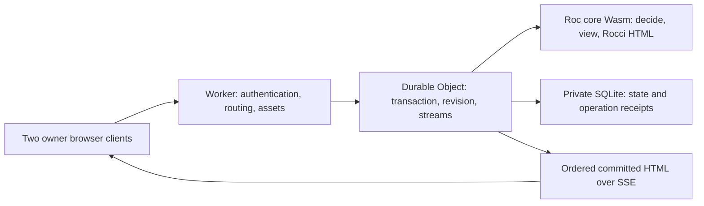

# Prove a remote Rocci backend on durable actors

## Goal

Run actual Roc command logic and compiled Rocci HTML rendering **inside a
Cloudflare Durable Object**, using the existing live-counter application.
Demonstrate two browsers viewing one durable counter, correct retries,
reconstruction after activation, and a repeatable private deployment.
This is a backend integration experiment; a native origin that renders on
behalf of the object does not satisfy its execution gate.

The owner selected Cloudflare first, live-counter, two browser clients first,
and a strictly private demo for `human:nils`. celld is a later portability
gate. The owner requested a recommendation between a small host and unchanged
effectful handlers, with both paths explained. These are task-scope choices,
not approval of a new public Rocci platform contract.

**Recommendation:** share pure Roc decisions and Rocci components across a
small native control and a TypeScript Durable Object host. Keep provider
storage, authentication, lifecycle, and streams in the host. The broader
unchanged-handler alternative is specified below.

This plan follows the [backend research](/research/rocci/portable-actor-backends.md).
Writing the original plan did not implement or deploy anything.[^research]
The owner subsequently requested execution. Implementation and dated local/
hosted results now live in the separate [status record](/status/portable-actor-backends.md);
remaining acceptance gates are explicit there. The phase exits below remain
the criteria rather than assumed successes.[^implementation-results]

## Out of bound

- A new task-board application, game timing, or conversion of every example.
- Public anonymous traffic, accounts for other users, a tenant-management UI,
  offline writes, local/remote synchronization, or desktop integration.
- A complete replacement for the native Rocci platform, unchanged execution
  of arbitrary effectful handlers, or a new language declaration.
- External jobs, email, durable workflows, alarms, event sourcing, and a
  general SQL abstraction. The selected counter does not need them.
- Production readiness, multi-region writes to one counter, a native origin
  fallback presented as a successful actor backend, or celld failure testing
  presented as already complete.

## Constraints that do not move

1. Durable state remains server-owned; browser signals may hold the existing
   origin selection and transient request metadata. Rocci components remain
   pure functions of explicit inputs.[^state][^render]
2. Roc performs increment/reset decisions, origin mapping, view construction,
   and HTML rendering. TypeScript may decode an envelope and persist results;
   it must not reimplement the counter's domain behavior or templates.
3. Persist values, schema version, state revision, and operation receipts.
   Reconstruct Wasm instances, SQL capabilities, and subscriptions on
   activation. Never persist a Roc closure or a native handle.
4. Successful commands remain finite empty SSE for Datastar and 204 for
   ordinary callers. The live GET owns updates to the counter and feed.
   Authentication and application errors receive explicit non-success HTTP
   statuses and a tested browser error path.[^runtime]
5. Provider identity, deployment configuration, and storage stay outside
   `.rocci` parsing. Preserve the native example and its use by the rocci.dev
   island while extracting reusable code.[^counter][^counter-ui]
6. The first hosted demo is owner-only and same-origin. Two authenticated
   browser profiles for the same owner are sufficient. No paid plan upgrade
   or additional provider is assumed by this plan.

## Evidence and the first hard risk

Evidence was checked on 19 October 2026 at Rocci `97227bf514da`, with the
pre-existing draft backend research and its index/log edits preserved.

| Current evidence | Consequence for this experiment |
| --- | --- |
| The ordinary `pf` is a native platform with process `init!`, `respond!`, and `shutdown!`, plus a wide effect surface. | Do not reinterpret process initialization as once-ever object creation. [^native][^native-abi] |
| Native SQLite exposes pools and pinned transaction handles. | A Durable Object SQL callback is a different capability; preserve atomicity rather than pretending the handle APIs are equivalent. [^sqlite] |
| The existing WASI HTTP path is experimental WASI 0.3 and uses a separate build/link path. | It is useful build evidence, not a Workers deployment artifact. [^wasi] |
| Current Rocdown Wasm mode still uses a native applicator for page rendering. | Its parity result cannot satisfy independent Roc/Wasm execution. [^wasm-host] |
| `.rocci` components lower to ordinary Roc and can use a supplied `Html` module. | A private platform/glue experiment can reuse compiled components without a parser feature. [^template] |
| Workers supports imported core Wasm; WASI support is partial and experimental. | First prove a callable core-Wasm module with explicit imports, exports, allocation, and cleanup. [^cf-wasm] |

Stop before cloud/application work if the actual pinned Roc compiler cannot
produce that artifact. A JavaScript counter, hardcoded HTML, or native proxy
does not convert a failed ABI experiment into a successful milestone.

## Demonstration and reusable source

Use `examples/rocci/standalone/live-counter` as the source application.
Retain increment, reset, count, origin selection, and the latest 50 click
records. Reset continues to clear the count while keeping the feed. Reuse
`Origin.roc` and `LiveCounterUi.rocci`; keep stable targets `#counter` and
`#counter-feed`, extracted CSS, and pinned Datastar assets.[^counter][^counter-ui]

Add a sibling experimental deployment directory, provisionally
`examples/rocci/remote/live-counter/`, containing the Worker host, a private
Roc platform/ABI shim, configuration, conformance runner, and runbook. Its
build consumes shared source rather than committing a copied renderer.
Final directory names are implementation choices, not existing commands.

Extract a small `CounterCore.roc` next to the current example. The native
handlers and actor host both call it. It accepts canonical counter/feed
values, a typed increment/reset command, and a supplied timestamp. Keep I/O
in each host. Move the pure document component out of the effectful entry
module into a shared UI module as needed, so the Worker build does not import
`pf.Sqlite` merely to render a page. Preserve the existing entry file and
public island imports.
The native control may improve transaction atomicity as part of this
extraction; record that intentional change and test it directly.

The proof script must visibly show:

1. Browser A increments; A and B show the new count and one feed entry.
2. Browser B increments; both converge again. Reset keeps the feed.
3. Repeating one operation ID changes the state exactly once; reusing it with
   a different command is rejected.
4. Close B, mutate in A, reopen B; B receives a current complete snapshot.
5. Reconstruct/deploy the actor, reconnect, and retry an ambiguous command;
   every acknowledged revision remains present without an extra increment.
6. A second configured counter key stays independent. This is an isolation
   fixture, not a tenant-management feature.

## Small host contract



The following interfaces are proposed value contracts, not current Roc APIs:

```text
decide(state, command, supplied_time)
    -> rejected(reason) | accepted(next_state)

view(state, supplied_time) -> counter_view
render_document(counter_view) -> utf8_html
render_live_slice(counter_view) -> utf8_html
```

The host authenticates the request and selects the logical counter key;
Roc receives a validated typed command: `Increment { origin, tz }` or `Reset`.
The host performs real JSON decoding and structural validation; do not use
the current substring-based `Origin.signal_str` helper as a new protocol
decoder. Roc keeps the chosen-origin/browser-timezone/UTC fallback and
`Origin.lookup`/place-label semantics.[^origin] A versioned UTF-8 JSON envelope is
acceptable across this server-side ABI. It does not become a browser domain
model. Keep envelope ABI version distinct from stored schema version and
counter revision.

Compile one core Wasm module containing real Roc functions and generated
Rocci functions. A narrow C/Rust shim can expose byte-buffer entry points
and own conversion to the Roc ABI. Prove the precise symbols with the pinned
compiler rather than assuming `main` is callable as a reusable renderer.
Inventory every import. Do not add filesystem, socket, shell, blocking sleep,
or WASI HTTP dependencies merely to satisfy link errors.

Define memory ownership before host integration: caller input ownership,
result pointer/length and lifetime, allocation/free or invocation-arena
reset, trap cleanup, and memory-growth policy. Copy output before freeing
it. Validate bounds and UTF-8. Represent I64/revision values as decimal
strings across JavaScript/JSON or reject outside a documented safe range.
Share the compiled `WebAssembly.Module`; use a separate mutable instance per
active actor initially. Do not share a module-global application heap across
objects. Measure the cost of that choice under multiple active objects.

The TypeScript host owns HTTP, SQL, operation receipts, durability barriers,
stream registries, and time. Its command critical section is synchronous.
Network calls and asynchronous initialization finish outside that section;
there is no promise inside `transactionSync`. External awaits can interleave
events even within one Durable Object.[^cf-sql][^cf-concurrency]

## Stored state and command protocol

Use two application tables initially:

| Table | Minimum content |
| --- | --- |
| `counter_state` | Singleton row; schema version, monotonic revision, canonical JSON containing count and at most 50 ordered click records |
| `operations` | Operation ID, authenticated owner, command/payload digest, stable result, resulting revision, accepted time |

Give each increment a never-reused click sequence, such as its accepting
state revision. Roc prepends/prunes by that sequence, not timestamp or count;
equal-second clicks remain ordered and reset cannot reuse click identities.
Verify the existing descending-ID feed behavior, including trimming and
reconstruction.[^counter]

Pass the loaded row revision alongside the JSON value in the Roc state
input. A checked next revision identifies the decision's accepted mutation;
persist it once in the row and receipt. Reject revision/count overflow
explicitly rather than wrapping or converting through an imprecise JS number.

Keeping this bounded aggregate in one JSON row avoids porting the entire
native SQLite API. The operation table is separate so its retention does not
inflate every render input. A POC counter accepts at most 10,000 operations;
retain all receipts until explicit experiment reset/export. Reject further
commands at the cap. This gives an honest retry horizon without an unbounded
database or silent receipt expiry. Export includes the receipts.

Define the envelope before hashing: ABI version, command tag, operation ID
(a validated UUID, at most 64 ASCII bytes), and the command's bounded fields.
Limit `origin` and `tz` to 128 UTF-8 bytes each and reject unknown fields.
Digest a canonical encoding of the command tag/version and decoded field
values; preserve empty values for Roc's fallback logic. Exclude supplied
server time, operation ID, Access tokens, and transport headers. Keep identity
as a separate receipt key/check. Retries then compare the same command even
when authentication tokens and server time change.

For each mutation:

1. Authenticate, verify allowed counter key and same-origin/CSRF policy, and
   reject oversized input before decoding. Use the existing 8 KiB action-body
   limit as the initial bound; return 413 rather than treating failure as an
   empty command.[^counter]
2. Obtain the command's stable operation ID and canonical payload digest.
   Inside one synchronous SQL transaction, check the receipt and operation
   cap, load state, run Roc `decide`, and write the accepted next state, next
   revision, and receipt atomically. Existing owner/payload matches return
   the stored outcome; mismatches return 409. Check duplicates before the
   cap so retries still work after capacity is reached.
3. Validate next-state bounds and renderability before accepting it. Structural
   invalidity returns 400; Roc domain rejection returns 422; operation-cap
   exhaustion returns 429. These rejected attempts do not mutate state or
   consume receipts; their result may change on a later retry and is not an
   accepted-operation guarantee. A thrown error returns 500 and rolls back
   all writes. Increment/feed/retention pruning become one mutation rather
   than the current separate statements. The accepted result must remain
   within the state/output caps, including escaped HTML expansion.
4. Cross the documented storage durability/output barrier before exposing
   success or a live update. Validate `storage.sync()` plus output-gate
   behavior for stream enqueue in the pinned runtime. Capture an immutable
   state/revision with the transaction; publish that snapshot only after its
   barrier completes. A later reread may include writes not covered by the
   completed flush, so it needs its own barrier. Maintain a durable publication
   watermark and discard older completions; apply the same rule to initial
   snapshots and presentation timers.[^cf-sql]
5. Notify read streams from committed canonical state. A crash between commit
   and notification is repaired by full snapshot on reconnect. No replay log
   or outbox is required for this counter.

Every user intent gets a fresh operation ID; transport retries reuse it.
The browser adapter may retain a pending command envelope as transient
request state until a definite response. Test this with the pinned Datastar
version; do not assume its automatic retries preserve a newly evaluated
random-ID expression. The current UI buttons issue bare `@post` calls, so
add a remote-only action wrapper or a narrowly scoped optional component
hook. It must allocate one envelope per click, allow distinct clicks to have
distinct IDs, reuse an ID on retry, and preserve existing native/island
defaults.[^counter-ui] If a reload loses the envelope, report the outcome as
unknown and resync; do not silently submit a fresh increment. Parallel
distinct increments serialize and all count. Reset is ordered by the actor's
commit order. Expected-version conflicts are optional protocol tests, not
a reason to reject every concurrent increment.

## Live HTML and reconnect

One live GET carries the counter and feed as one ordered update batch. Keep
the existing two stable-ID targets and controls outside them. Commands do
not also patch those targets. The current dispatcher polls and renders every
100 ms per connection; this adapter instead renders on committed changes
and explicit presentation-clock ticks.[^dispatch]

Register the subscriber and capture its starting snapshot in one synchronous
actor turn. Queue it for delivery through its durability barrier. If that
requires an await, register first, capture the snapshot to flush, and deliver
only a snapshot covered by a completed barrier. Discard it if a later durable
snapshot has already reached that subscriber. This closes the read/subscribe
race without publishing a newer unflushed reread. All reads and renders use
one canonical snapshot, so count and feed cannot come from different commits.

Use one render per equivalent audience, then fan out the framed HTML. The
private POC has one owner/audience. Each stream has at most one pending full
snapshot batch in addition to bounded transport buffering; coalesce to the
newest snapshot or disconnect a slow reader. Do not await a slow client in
the mutation path. Remove cancelled streams and timers promptly. Serialize
delivery and discard obsolete pending work before enqueueing it.

The feed's relative-age text depends on time even without writes.[^origin]
Preserve it with an active-view presentation timer, at most once per minute
for this example, plus rendering on connect and mutation. Supply time to
Roc; do not write a fake state mutation to refresh text. This deliberately
permits roughly one minute of additional label staleness compared with the
native poll loop; test minute/hour/day boundaries and a clock refresh racing
with a newer mutation. Presentation timers use the last durable snapshot.
Distinguish durable state revision from per-stream delivery sequence: a newer presentation of
the same state is valid. Reconnect always starts with a fresh snapshot;
event IDs are diagnostic cursors and do not imply replay or client-side
stale-patch rejection.

Send a separate heartbeat at approximately 15 seconds. Test flushing,
proxy buffering, cache headers, cancellation, browser suspension, and idle
periods of at least ten minutes through the real hosted origin. Streaming
through a Worker is supported, but a pending SSE response prevents ordinary
object hibernation. Do not claim the economics of hibernating WebSockets
for this SSE design.[^cf-stream][^cf-lifecycle]

## Private deployment design

Use one dedicated staging Worker, one SQLite-backed counter class, one
namespace, and same-origin static assets. Keep script name, class name,
namespace, and logical key stable. Keep experimental state separate from
rocci.dev and existing production counter data.

Place a Cloudflare Access application on the staging hostname, allow only
the owner's identity, and validate Access JWT signature, issuer, audience,
and expiry in the Worker before actor routing. Do not trust a caller-supplied
identity header.[^cf-access] Verify signed-out denial for document, command,
stream, export, and asset paths. Configure `assets.run_worker_first: true`
and authenticate before forwarding to `env.ASSETS.fetch()` so asset-first
routing cannot bypass the script's checks.[^cf-assets] Persist
`workers_dev: false` and `preview_urls: false` in configuration, then enumerate
and test every remaining hostname. Disabling workers.dev alone does not
disable every preview surface.[^cf-hostnames][^cf-preview] Origin/CSRF checks
still apply to authenticated mutation requests. Keep operator export/import
behind the same owner boundary; do not add unauthenticated debug routes.

Use two browser profiles signed in as the owner. Run local conformance with
explicit identity fixtures and hosted checks through the owner's authenticated
browser session. Do not introduce a service-token principal into the initial
owner-only policy. Static assets include
the pinned Datastar JS and extracted CSS. Preserve the actual Datastar CSP
requirements already documented by Rocci rather than deploying a policy
that breaks event expressions.[^root]

Pin Roc, the shim toolchain, Node dependencies, Wrangler, and a Workers
compatibility date. Record source revision, generated-source hash, Wasm hash,
asset hashes, ABI/schema versions, and provider deployment version in the
build manifest. Build once and deploy the tested artifact. Keep output in
derived directories. Do not download or compile Roc in a request handler.

At implementation time, validate the installed Wrangler configuration
schema: current Cloudflare docs recommend declarative class `exports`, while
legacy tagged `new_sqlite_classes` migrations remain supported. celld
currently accepts a narrower legacy migration subset. Prefer the verified
common subset for this POC, or generate isolated provider configurations;
do not promise byte-identical configuration.[^cf-exports][^celld-objects]

Create the class/namespace once, independently from ordinary code updates.
Application SQL migrations have their own version and must be idempotent and
compatible with the previous code version. Class lifecycle changes have
special rollout/rollback restrictions; a code rollback is not a database
rollback.[^cf-deploy] The first upgrade drill is an additive schema change,
reconnect, and rollback to compatible code using the same namespace.

## Phased implementation

Dependencies are Phase 0 → 1 → 2 → 3 → 4 → 5. Phase 6 is a later option,
not required to declare the Cloudflare POC achieved.

### Phase 0 — Freeze the experiment and source baseline

**Bound:** the selected live-counter, private owner-only Cloudflare staging,
two browsers, a second isolation key, and no public runtime API commitment.

- Record exact tools and current HTTP/HTML behavior from the native origin.
- Capture count/feed fixtures, reset behavior, Unicode/origin mapping,
  current assets, and time-dependent labels. Inspect code rather than
  treating historical knowledge as current implementation.
- Choose proposed operating caps below and a disposable experiment name;
  record account plan availability without upgrading it.

**Exit:** a short reproducible scenario list, fixture set, build-input
manifest, and an implementation branch with unrelated work preserved.

### Phase 1 — Prove independent Roc/Wasm execution

**Bound:** the minimum initial pure-core extraction, one real increment/reset
decision, Origin helper use, and one real compiled `LiveCounterUi` component;
no database or live transport yet.

- Produce a callable core-Wasm artifact and inspect imports/exports.
- Establish the private staging hostname, owner Access policy, asset gate,
  and alternate-host denial before deploying the first probe.
- Run it in a local JS harness, `wrangler dev`, and then a method of the
  hosted Durable Object. A call only from the ingress Worker is insufficient
  to prove the required execution location. The hosted probe is the first
  remote deployment, not this plan.
- Exercise empty/full feeds, escaping, non-ASCII text, malformed envelopes,
  out-of-range integers, trap/error conversion, and 10,000 repeated calls.
- Compare Roc native and Wasm values/HTML for identical inputs and supplied
  time. Measure startup, peak/retained memory, artifact size, and per-call CPU.
- Activate both configured keys simultaneously with maximum fixture inputs
  and record initial/maximum Wasm pages plus combined isolate memory. Repeat
  this resource check with full stream queues in Phase 4.

**Exit:** actual Roc-generated decision and HTML in the hosted runtime,
explicit ownership/cleanup, parity fixtures, and measured resource headroom.
Timebox the first feasibility investigation to two engineering days. If it
fails, record the compiler/ABI blocker and stop; seek a separate scope choice
before replacing the core with native proxying or porting all effects.

### Phase 2 — Share the application core and native control

**Bound:** extract only values/decisions/view construction and reusable
rendering from the existing example. The native app remains runnable.

- Stabilize the Phase 1 `CounterCore.roc`, make native handlers use it, and
  transact count/feed changes together. Keep SQL ownership in native handlers.
- Lower existing components once for both builds; retain the same Html
  semantics and CSS extraction. Add the remote build script privately.
- Confirm reset/feed/origin behavior and the home-island import contract.

**Exit:** native HTTP behavior and UI remain correct; both hosts consume the
same domain/render source. Any intentional differences are documented.

### Phase 3 — Add durable actor mutations

**Bound:** two small tables, one owner, configured counter keys, synchronous
Roc calls, and bounded operation receipts.

- Implement initialization/schema reconstruction without a shutdown flush.
  Use a short `blockConcurrencyWhile` barrier where needed; do not hold it
  around a stream or long network request.[^cf-state]
- Implement atomic mutation and receipt lookup; add status/error mapping.
- Verify parallel unique commands, repeated IDs, mismatched payload reuse,
  reset ordering, independent keys, transaction rollback, oversized bodies,
  and read-after-acknowledgement.
- Inject failure before transaction commit and after commit before reply.
  Retry with the same ID and inspect state through the real actor read path.

**Exit:** exact final counts/feed, no partial accepted operations, and no
duplicate mutation after response loss. A second activation reads every
acknowledged revision from durable state rather than a warm heap.

### Phase 4 — Add two-browser SSE and recovery

**Bound:** one live stream per viewer, snapshot resync, bounded queues,
presentation-clock refresh, and the existing two morph targets.

- Implement subscribe/snapshot ordering and committed-change notification.
- Preserve finite command responses; explicitly wire the document's live
  subscription in this custom host rather than relying on generated native
  dispatcher injection.
- Exercise the snapshot/subscription race, rapid parallel commands,
  disconnect during commit, stale completion ordering, a slow reader,
  browser background/foreground, ten-minute idle, and reconnect.
- Confirm commands remain responsive when another viewer cannot drain.
  Check the actual pinned Datastar client's retry/cursor behavior.

**Exit:** both browsers converge after every scenario; rendered count/feed
refer to a coherent committed snapshot; stream/timer memory is reclaimed.

### Phase 5 — Package, deploy privately, and rehearse recovery

**Bound:** one reproducible owner-only staging deployment and one compatible
upgrade/rollback. No production promotion or public audience.

1. Build from pinned inputs, run conformance, and retain the artifact manifest.
2. Configure the staging namespace/assets/secrets and owner-only Access
   boundary; verify direct/alternate-host authorization before data tests.
3. Deploy the tested bundle, smoke the two-browser scenario, and observe
   command latency, stream count, SQL work, activation, and memory.
4. Export a populated counter plus operation receipts; verify schema,
   checksum, revision, and caps; restore into a separate disposable namespace.
5. Deploy adjacent compatible code/schema versions. Verify state continuity,
   in-flight retry, stream reconnect, and code rollback without deleting the
   namespace. Use local fault injection for precise crash points and a
   hosted update/reconstruction drill; do not claim arbitrary managed-node
   power-failure control.
6. Record a bounded idle/active cost forecast and the cleanup procedure.

**Exit:** a private URL, tested build/deploy/restore runbook, evidence of
acknowledged-state recovery, and a measured accept/iterate/stop decision.
Retire the disposable probe resources without deleting the retained demo's
data. Record required CI and Knowledge run IDs before logging implementation
phases as complete.

### Phase 6 — Later celld portability gate

**Bound:** reuse the actual Roc Wasm and application host source, isolating
provider configuration and authentication. No requirement to run both hosts
for the first Cloudflare milestone.

- Pin a celld release and retest its supported API subset. Current docs call
  v0.6.2 beta and require operator-owned fleet/ingress; this adds operations
  work rather than providing a managed Cloudflare account substitute.[^celld-limit]
- Start with `celld dev` and deploy the same core-Wasm module. Its documented
  Wasm imports support this route; they do not establish WASI HTTP component
  compatibility.[^celld-wasm]
- For a remote persistence claim, provision a supervised node, TLS ingress,
  private peer/operator network, and a qualified object-storage bucket. Run
  `celld diagnose` against the chosen bucket before durability tests. Test
  one-node restart, then two-node takeover and follower/bucket recovery if
  claiming fleet resilience.[^celld-guarantees]
- Preserve script/class names: celld derives named object identity partly
  from script name and restricts class lifecycle migrations.[^celld-objects]
- Re-run the same HTTP/HTML/receipt conformance suite. Exercise its documented
  60-second inactive/unclaimed stream behavior with heartbeats and reconnect,
  rather than assuming Cloudflare timeout behavior.[^celld-compat]
- Fence writes on the source, export values/receipts, import to the target,
  compare state/version/checksum, change routing, and force client resync.
  Keep the source read-only for rollback; do not introduce dual writers.

**Exit:** measured deployment on celld, passed conformance, and an actual
data cutover. Source compatibility alone permits only a narrower claim.
The announced celld/workerd convergence remains roadmap context until a
specific unified runtime has been tested.[^convergence]

## Alternative: preserve effectful handlers unchanged

Choose this path only if running the current `@init`, `Sqlite`, and handler
code unchanged becomes a separate requirement. It is a larger platform port,
and it does not remove the independent Roc/Wasm feasibility gate.

| Required work | Why the small host avoids it |
| --- | --- |
| A Worker-specific platform ABI for generated `init/respond/SSE/shutdown` calls and all reachable native hosted symbols | The small host calls bounded pure functions only. |
| Map `Sqlite.Db`, prepared rows, parameter types, errors, limits, and pinned transaction handles onto object SQL | The small host reads/writes two known application tables through provider APIs. |
| Define initialization, database paths/environment, repeat activation, and schema migration semantics | A process initializer and native path do not identify a durable object or once-ever creation. |
| Request/body/resource lifetime and complete response/SSE ABI adaptation | A byte-value call cannot preserve native handles implicitly. |
| Scheduling, cancellation, retained Roc source cleanup, and write-triggered wakeup | Reusing the generated 100ms polling loop preserves cost and residency problems. |
| Audit filesystem, compiler glue, command, outbound HTTP, TCP, sleep, and other transitive effects; implement or reject each explicitly | Workers cannot be treated as the native operating system. |
| Native/Worker behavior and capability conformance, plus CLI target/asset packaging and reference docs | This becomes a public platform/tooling contract rather than an example adapter. |

The native ABI and SQLite modules define the actual inventory.[^native-abi][^sqlite]
An initial limited compatibility port could cover only the effects reachable
from live-counter, but must advertise that subset. Existing handlers also
need atomicity and deduplication around multi-statement commands; preserving
their source literally does not provide those guarantees. Do not disguise
an asynchronous fetch as synchronous native I/O by spinning the event loop.

If selected later, begin with an effect-reachability audit and one SQL
transaction proof before route migration. Keep the small-host adapter as
the control. Re-estimate after the ABI gate; do not place this path inside
the first POC's completion criteria.

## Operating budgets and acceptance evidence

These are proposed POC caps and review thresholds, not provider guarantees:

| Dimension | Initial bound or evidence |
| --- | --- |
| Scope | One owner; two browser clients; two configured isolation keys |
| Input/state/output | 8 KiB command body; 50 feed rows; 256 KiB canonical snapshot; 512 KiB rendered batch |
| Receipts | At most 10,000 accepted operations per experiment; no silent expiry |
| Resources | Aim below 16 MiB total bundle, 500 ms global initialization, and 64 MiB measured isolate memory in the test workload; investigate rather than silently relaxing a miss |
| Correctness load | At least 100 distinct concurrent increments to one key and repeated submissions of one ID; exact expected count and one feed record per accepted increment within retention |
| Performance sample | Warm/activation latency distributions, Roc decide/render CPU, SQL rows read/written, bytes per update, and two viewers; an optional bounded 20-viewer sample follows the required scenario |
| Delivery | Nondecreasing committed state revision; per-stream ordered presentation; reconnect snapshot; bounded slow-reader backlog |
| Failure | Atomic rollback; committed/lost reply; actor reconstruction; deployment reconnect; export/restore; compatible rollback |

Current Workers docs list 128 MB isolate memory including Wasm, a 64 MiB
uncompressed bundle ceiling, and a one-second global startup budget.
Multiple instances in one isolate share the memory budget. Measure actual
headroom rather than treating these ceilings as app targets.[^cf-limits]

For cost, collect active object-hours, requests, SQL row operations/storage,
and any calling-Worker charges. Concurrent viewers on one active object
share its duration allocation; separate active objects do not. Use actual
account-plan allowances and current published rates. A one-owner SSE demo
does not prove cheap idle hosting at large object counts.[^cf-price]

Suggested sequencing is a two-day ABI feasibility timebox, then separate
reviewable slices for shared core, transactions, live delivery, and deployment
recovery. Estimate those slices after the ABI result. celld and unchanged
effects receive separate estimates. This avoids turning compiler uncertainty
into an unsupported delivery date.

## Ownership, checks, and handoff

Start private build/host glue in the example. Promote shared functionality
only after both native and hosted evidence justify it. Build orchestration
belongs in `rocci-cli`; platform/runtime glue belongs in the runtime layer;
durable-object routing and storage do not belong in `rocci-template`. If a
new Cargo workspace member becomes necessary, classify it in
`rocci-ops/src/rocci_ops/workspace_deps.py` in the same change.

During implementation, use the authoring skill for `.roc`/`.rocci` extraction
and run narrow crate checks while iterating. Rust changes require
`cargo fmt --all -- --check`; multi-crate changes require the offline
`cargo test --workspace` suite. Run actual generated Roc/Worker probes in a
separate opt-in lane; offline Rust tests cannot prove this deployment.
Verify the native example, the shared site-island call shape, browser behavior
through the real origin, and the exact deployment artifact. Update owning
READMEs and `docs/reference/runtime.rocdown` when experimental behavior is
introduced, labeling it experimental; no public contract changes arise from
this plan alone.

Save implementation results in a separate linked status/audit record with
source/artifact/deployment identifiers, tool versions, scenarios, metrics,
failures, and the limits of fault injection. Do not fill this plan's Exit
criteria with assumed successes. Run `okmate check knowledge --profile base`
after knowledge edits; keep lifecycle/provenance warnings distinct from
errors. No implementation phase starts until requested.

[^root]: Native runtime overview, pinned assets, and Datastar CSP requirements.
[^implementation-results]: Implementation evidence, exact artifacts, deployment identifiers and remaining gates.
[^research]: Exploratory comparison and proposed portability semantics; not deployment evidence.
[^state]: Established server-owned-state direction.
[^render]: Established pure-render-component boundary.
[^native]: Native platform packaging and target limitations.
[^native-abi]: Actual native lifecycle exports and broad hosted capability surface.
[^sqlite]: Native pool/transaction API that cannot be renamed into provider SQL semantics.
[^wasm-host]: Existing site Wasm path is not independent rendering.
[^wasi]: Current separate experimental WASI 0.3 component path.
[^template]: Components lower to ordinary Roc; supplied Html imports are supported.
[^counter]: Current increment/reset, separate SQL statements, feed retention, and body limit.
[^counter-ui]: Stable counter/feed targets, Origin use, controls, and extracted component styling.
[^origin]: Pure origin mapping and minute/hour/day relative-age buckets.
[^dispatch]: Current per-connection 100ms rendering and finite command responses.
[^runtime]: Current HTTP/Datastar contract and explicit live subscription behavior.
[^cf-wasm]: Core Wasm can run through JavaScript; WASI support is experimental and partial.
[^cf-sql]: Synchronous SQL callbacks, rollback, output durability, and application data recovery.
[^cf-concurrency]: Input/output gates do not serialize arbitrary external awaits.
[^cf-state]: Initialization/concurrency barrier and its bounded lifecycle.
[^cf-stream]: Official response streaming and cancellation path.
[^cf-lifecycle]: Activation reconstructs heap; pending HTTP responses prevent hibernation.
[^cf-limits]: Current bundle/startup/isolate-memory ceilings, checked October 19.
[^cf-price]: Object duration, requests, SQL rows, and storage are distinct billing dimensions.
[^cf-exports]: Current configuration supports new declarative exports and legacy migrations.
[^cf-deploy]: Class lifecycle changes constrain rollout and rollback independently of SQL schema.
[^cf-access]: JWT validation requirements for protecting the application origin.
[^cf-assets]: Worker-first routing ensures the authentication gate runs before asset serving.
[^cf-hostnames]: Configuration must persist alternate workers.dev hostname disablement.
[^cf-preview]: Preview URL controls are distinct from workers.dev route enablement.
[^celld-wasm]: Imported core Wasm deployment route.
[^celld-limit]: Beta maturity and operator-owned fleet/ingress constraints.
[^celld-objects]: Named object identity, activation, SQL, and supported migration subset.
[^celld-compat]: Stream inactivity/retry and deployment compatibility differences.
[^celld-guarantees]: Qualified conditional bucket writes, acknowledgements, and recovery prerequisites.
[^convergence]: Announced future convergence does not establish a deployed unified runtime.
